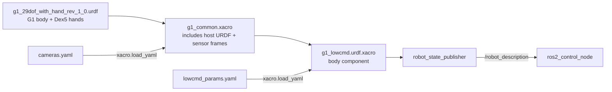

# g1_description

The G1 robot description: a plain URDF containing the G1 body and bilateral RH56E2 (Dex5) hands,
plus xacro wrappers that add shared sensor frames and the body's `ros2_control` block.



## Contents

| Path | Purpose |
|---|---|
| `urdf/g1_29dof_with_hand_rev_1_0.urdf` | Plain URDF with the G1 body, fixed wrist mounts and complete left/right RH56E2 hand models. |
| `urdf/RH56E2_L_2025_9_10.xacro`, `urdf/RH56E2_R_2025_9_11.xacro` | Source SolidWorks exports retained for provenance; their hand link/joint data is copied into the plain URDF. |
| `urdf/g1_common.xacro` | Includes the plain host URDF and adds shared sensor frames. Loaded by geometry-only consumers. |
| `urdf/g1_lowcmd.urdf.xacro` | Includes `g1_common.xacro` and adds the body's `<ros2_control>` block. This is the entry point. |
| `config/lowcmd_params.yaml` | The body component's parameters and its per-joint position-only gains. |
| `config/cameras.yaml` | Where each camera mounts. The URDF builds the chest camera's frames from it and the simulator renders every camera from it, so a camera moves in this file alone. The head entry mirrors Unitree's `d435_joint`. |

The G1 visual meshes are not committed. CMake copies them at configure time from
`/opt/unitree_robotics/unitree_mujoco/unitree_robots/g1/meshes`, overridable with the
`G1_VENDOR_MESHES` cache variable. If that directory is missing, the build warns and RViz shows no
G1 body model.

The YAML files are loaded with `xacro.load_yaml` and expanded into `<param>` tags, because
`ros2_control` hardware plugins only receive parameters that way, never from `controller_manager`'s
own YAML.

## Components and frames

The lowcmd xacro emits one `<ros2_control>` block:

| Component | Plugin | Joints |
|---|---|---|
| `G1LowCmdSystem` | `g1_hardware_interface/G1LowCmdSystem` | All 29 body motors, legs and waist included, plus the `imu` sensor. |

The common wrapper adds sensor frames to the host URDF:

| Frame | Parent | Purpose |
|---|---|---|
| `camera_depth_optical_frame`, `camera_color_optical_frame` | `d435_link` | REP 103 optical frames of the head camera. |
| `chest_camera_link` and its two optical frames | `torso_link` | The chest camera, placed by `cameras.yaml`. |
| `mid360_imu` | `mid360_link` | The Mid360's built-in IMU, FAST-LIO's body frame. |
| `d435_visual`, `chest_camera_visual`, `mid360_visual` | their sensor links | Bodies for RViz. Visual only, so they stay out of MoveIt's planning scene. |

## Parameters

`config/lowcmd_params.yaml` sets the body component's parameters, described in
[g1_hardware_interface](../g1_hardware_interface/README.md#parameters), and a
`position_only_kp` and `position_only_kd` per joint. `config/dex5_params.yaml` sets the left Dex5
component (see [Dex5 (RH56E2) hands](#dex5-rh56e2-hands)).

## Inspecting the model

```bash
./scripts/manage.sh exec xacro src/g1_description/urdf/g1_lowcmd.urdf.xacro -o /tmp/g1.urdf
./scripts/manage.sh exec check_urdf /tmp/g1.urdf
```

RViz (`rviz:=true` on `bringup.launch.py`) draws the model. The MuJoCo viewer shows the simulator's
own MJCF instead.

## Tests

```bash
./scripts/manage.sh test g1_description   # none of these needs a simulator
```

| Test | Checks |
|---|---|
| `test_lowcmd_xacro` | Expands the xacro, validates it with `check_urdf`, and asserts the body component's 29 joints and command interfaces. |
| `test_dex5_urdf` | Checks the plain host URDF's exact hand model data, mounts, tree, mimic relations, mesh URIs, and wrapper expansion. |
| `test_motor_order` | `kG1JointNames` in `g1_hardware_interface` lists the 29 motors in SDK order and names only joints the host URDF has. |
| `test_sensor_mounts` | The simulator's compile-time LiDAR mount (`kMountXyz`, `kMountRpy` in `sensor_publisher.cc`) matches the URDF's `mid360_joint`, and the head entry in `config/cameras.yaml` matches `d435_joint`. The simulator links no ROS, so it cannot ask TF where a sensor is. |
| `xmllint_description_g1_description` | Every URDF and xacro is well-formed XML, which xacro does not enforce. |

## Dex5 (RH56E2) hands

The complete bilateral RH56E2 link and joint descriptions, including inertials, visual and collision
declarations, force-sensor and palm links, limits and mimic relations, are flattened into
`urdf/g1_29dof_with_hand_rev_1_0.urdf`. Fixed joints `left_dex5_mount_joint` and
`right_dex5_mount_joint` attach each hand root to its wrist yaw link.

- **Wrist mount origins are provisional zero placeholders, not physically verified fit values.**
  Measure and validate the actual hand-to-wrist transforms before using the model for motion or
  collision planning. These transforms are fixed in the plain URDF, not xacro parameters.
- **Meshes are not committed.** Place the original, case-sensitive STL files in
  `workspace/src/g1_description/meshes/dex5_left/` and
  `workspace/src/g1_description/meshes/dex5_right/`; for example, `base_link.STL` and
  `left_thumb_1.STL` in the left-hand folder. They install to
  `share/g1_description/meshes/dex5_{left,right}/` and are referenced through
  `package://g1_description/meshes/dex5_{left,right}/<name>.STL`. RViz visual validation requires
  those mesh files and has not been performed.
- `*_hand_grasp_frame` names remain as compatibility frames at the source palm-link origins. Their
  zero offsets are not calibrated grasp points. Any consumer still expecting Dex3 links, joints or
  grasp geometry needs a separately scoped compatibility update.
- **Control scope: simulation only, left hand only.** `urdf/g1_lowcmd.urdf.xacro` adds a second
  `ros2_control` component, `G1Dex5SystemLeft`, next to the 29-joint `G1LowCmdSystem`. It claims
  exactly `left_thumb_1_joint`, `left_thumb_2_joint`, `left_index_1_joint`, `left_middle_1_joint`,
  `left_ring_1_joint` and `left_little_1_joint`, in that order, with a position command and
  position, velocity and effort state, in radians. The distal mimic joints (`thumb_3`, `thumb_4` and
  every `*_2`) are never claimed; the URDF computes them. The right Dex5 stays in the URDF with no
  component and no controller.
- The xacro argument `dex5_backend` (default `sim`) picks the plugin through `backends:` in
  `config/dex5_params.yaml`. `sim` is `g1_hand_interface/G1Dex5SimSystem`, which opens no DDS
  channel and needs no hand. A physical backend would be one more entry there, behind the same
  joints. None exists: there is no Modbus/TCP, touch-sensor or MuJoCo hand model in this change.
- The per-joint `min`/`max` in `dex5_params.yaml` copy the URDF limits, and `test_lowcmd_xacro`
  checks they still match.
