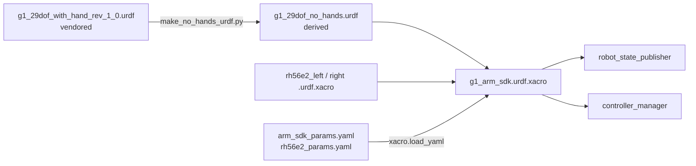

# g1_description

The Unitree G1 robot description: a vendored, kinematics-only URDF plus a xacro wrapper that adds
the `ros2_control` block for the arms.

`ament_cmake`, no compiled code.



## Contents

| File | Purpose |
|---|---|
| `urdf/g1_29dof_with_hand_rev_1_0.urdf` | The vendored upstream description, with Unitree's Dex3-1 hands. Kept for diffing against Unitree's file; nothing loads it. |
| `urdf/g1_29dof_no_hands.urdf` | **Generated** from the file above by `scripts/make_no_hands_urdf.py`: the same robot with the Dex3 palm and finger links removed. Each palm link is left as an empty frame. A test fails if it drifts. |
| `urdf/rh56e2_{left,right}.urdf.xacro` | The Inspire RH56E2 hands, as macros mounted on those palm frames. The vendor's export with the edits listed in each file's header. |
| `urdf/g1_arm_sdk.urdf.xacro` | Includes the three above, appends the `<ros2_control>` blocks for the arms and hands, and defines the `{side}_hand_grasp_frame` links. |
| `config/arm_sdk_params.yaml` | Every arm hardware-plugin tunable. |
| `config/rh56e2_params.yaml` | The hand's driven joints and limits, plugin tunables, topics, **where each hand is mounted** and where it grasps. |
| `meshes/` | Vendored G1 visual meshes (installed at configure time so the model renders in RViz), and `meshes/rh56e2/` for the hands, which are checked in. |

Parameters are loaded with `xacro.load_yaml` and expanded into `<param>` tags because Humble
hardware plugins only receive parameters that way.

## Scope: arms and hands, not legs

The xacro emits three `<ros2_control>` blocks: the 14 arm joints on `G1ArmSdkSystem`, and six
driven finger joints per hand on a `G1HandSystem` each. Legs and waist belong to the onboard
controller, which is what keeps the robot balanced; claiming them here would mean owning balance.

One component per hand, separate from the arm, because a hand is a separate device on its own
topics with its own control authority, and because a hand fault should not take the arms down
with it.

## The hands

Inspire RH56E2: five fingers, twelve non-fixed joints per hand, **six of them driven** (`thumb_1`,
`thumb_2`, and `index_1`, `middle_1`, `ring_1`, `little_1`). The other six are URDF mimics of
those, so `ros2_control` declares six, MoveIt plans six, and `robot_state_publisher` computes the
rest. Every range starts at 0 (open) and closes positive, on both hands.

Link and joint names keep the vendor's spelling (`left_dex5_base_link`, `left_plam_1`,
`left_thumb_1_joint`) so a new export can be diffed against what is here. The exception is the
arm-to-hand interface, which keeps the names the rest of the stack already uses:
`{side}_hand_palm_link` is an empty frame at the wrist flange, and `{side}_hand_grasp_frame`
hangs off it. The RH56E2's base link is mounted on the palm frame.

**Two things in `rh56e2_params.yaml` are estimates and should be checked in RViz first.** The
mount rotation is derived from the vendor's finger axes, not measured; if the hand looks rolled
or the thumb is on the wrong side, change the roll there by pi. And the grasp frame is an
estimate of where the fingers close.

### Regenerating the hand-less URDF

```bash
python3 workspace/src/g1_description/scripts/make_no_hands_urdf.py          # rewrite
python3 workspace/src/g1_description/scripts/make_no_hands_urdf.py --check  # verify
```

## Parameters

`config/arm_sdk_params.yaml`:

| Parameter | Default | Meaning |
|---|---|---|
| `command_publish_rate` | 100.0 Hz | `/arm_sdk` publish rate, independent of the controller manager's update rate. |
| `blend_ramp_up_s` | 2.0 s | Weight eases 0 to 1 on activate. |
| `blend_ramp_down_s` | 2.0 s | Weight eases 1 to 0 on a clean deactivate. |
| `emergency_ramp_down_s` | 0.5 s | Faster ramp on stale feedback or shutdown. Must fit inside the launch stack's SIGTERM window. |
| `max_joint_velocity_rad_s` | 1.0 rad/s | Slew clamp on every commanded joint. |
| `lowstate_timeout_ms` | 100 ms | `/lowstate` age beyond this trips the emergency ramp. |

The file also carries the per-joint motor index and gains. Motor indices are the Unitree DDS wire
order and are not ours to renumber.

## Inspecting the model

```bash
xacro workspace/src/g1_description/urdf/g1_arm_sdk.urdf.xacro > /tmp/g1.urdf
check_urdf /tmp/g1.urdf
```

For actual geometry, use the MuJoCo viewer once `g1_bringup` launches the simulator, or RViz with
`rviz:=true`.

## Tests

```bash
colcon test --packages-select g1_description
```

`test_arm_sdk_xacro` expands the xacro, validates it with `check_urdf`, and asserts the
`<ros2_control>` blocks hold exactly the 14 arm joints and six driven joints per hand.
`test_rh56e2_hands` checks what the vendor's export is easiest to break: the driven set, no
mimic chains, zero-to-positive ranges, the mount. `test_no_hands_urdf` fails if the derived
URDF has drifted from its source. No simulator needed.
