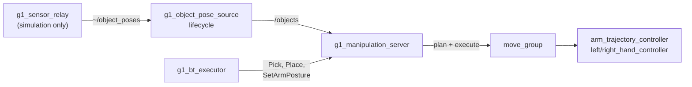

# g1_manipulation

Pick and place, served as actions over MoveIt, plus the node that decides where object poses are
allowed to come from.

`ament_cmake`, C++20. Two nodes.



The server adds no command path. It is another client of `move_group`, which is another client
of the controllers that already own `rt/arm_sdk` and the hand topics, so every low-level channel
keeps exactly one writer.

It also takes no control authority. The arm and hands must already be acquired before a goal
will execute, and releasing them is the caller's job — for a mission that is
`g1_orchestration`'s executor, which brackets the whole run. A skill that acquired per goal
would hand the hands back between pick and place and drop what it was carrying.

## Where object poses come from

`g1_object_pose_source` is the boundary between manipulation and perception. Skills consume
`/objects` and never learn which source filled it, so a real detector replaces this node without
touching them.

| `object_source` | Behaviour |
|---|---|
| `sim_ground_truth` | MuJoCo body poses, sampled inside the simulator and carried out by `g1_sensor_relay`. |
| `depth_tracker` | Measured poses from `g1_perception`'s model-based tracker on the head depth camera, for the parts it has models of. Same on the robot as in the simulator. See `g1_perception/README.md`. |
| `hardware` (default) | **Refuses to configure.** There is no general object detector; use `depth_tracker` for modelled parts. |

`hardware` is the default deliberately, matching `g1_state_estimation`'s odometry source: a
bring-up that forgets to say what it has must fail visibly rather than feed a grasp planner
simulator ground truth it cannot tell from a measurement.

Ground-truth poses are exact — no noise, no occlusion, no misdetection, and every listed object
is always visible. `depth_tracker` poses are measurements: an object appears only while it is
tracked and verified against the depth image.

`/objects` is `vision_msgs/Detection3DArray` in `odom`, carrying a pose and a bounding box per
object. The box is what the server builds its collision geometry from, so replacing the source
with a real detector changes nothing downstream.

## Actions

| Action | Goal | Notes |
|---|---|---|
| `~/pick` | `object_id`, `arm` | No pose in the goal: it is read from `/objects` when the goal starts, so a retry re-reads rather than replaying. |
| `~/place` | `surface_object_id` **or** `pose`, `arm` | Prefer the surface: it is read from `/objects` and the object is stood on top of it. A `pose` is where the **object** ends up, not the hand, transformed into the planning frame on arrival. |
| `~/set_arm_posture` | `group`, `named_target` | Named SRDF poses only. |

`Pick` and `Place` publish a phase as feedback and name that phase in the result on failure.
Every `Pick` failure path leaves the hand open and nothing attached, so a retry starts from a
defined state rather than part-way into a grasp — that is what makes the behavior tree's retry
meaningful rather than a replay.

## Objects that publish their own grasp

A detection may carry more than its pose. `g1_perception`'s tracker adds, after the object's own
result:

- `<object>/grasp/<name>`: where a hand takes it. `Pick` uses these instead of the bounding-box top
  grasp below. A published grasp fixes where the hand closes and across what; the tilt of the
  fingers about the closing axis is left free. Each grasp is expanded into tilts up to
  `grasp_tilt_max_deg` (15) in `grasp_tilt_step_deg` (15) steps, and turned over if
  `grasp_allow_flip` (off: a turned-over hand twists the wrist into odd postures), and leaned up to
  `grasp_lean_max_deg` (60) about the grasp's z. Tilts whose fingers do not come down by at least
  `grasp_min_descent` (0.25, the z of the approach direction: no side approaches) are dropped. The nearest to the published pose is tried first. Every variant is checked with IK for both arms
  under `arm: auto`, nearest side first. The published tilt is tried first, then the nearest ones,
  and at most `grasp_max_plans` (6) reachable ones are planned to.

  Reach for a grasp near pelvis height, 0.1 m to the side, from an IK sweep of the arm: nothing
  past about 0.43 m ahead of the pelvis; at 0.36 m, tilts within 30 degrees of vertical; at 0.28 m,
  up to 45 degrees either way. The pose is the RIGHT hand's grasp frame at the grasp, the point it
  pinches (x along the fingers, which is the approach direction; the four fingers on -y, the thumb
  swung across on +y; the hand goes down in the SRDF's `pinch_open` shape when it has one), and the
  left hand takes the same pose turned half a turn about x. A grasp can bring its own hand states:
  `<grasp>_open` to go down in and `<grasp>_closed` to close to, looked up by its name cut back one
  `_part` at a time (`side_right_090` finds `side_open` and `side_closed`). A name with a `right`
  or `left` part (`side_right_090`) is only for that hand. The hand goes to a point `grasp_approach_m`
  (0.20) back along the fingers, re-reads the part's pose and re-aims if it moved (up to
  `reaim_max_shift_m`, 0.04; more aborts as knocked), then goes straight in on a Cartesian path, closes, and lifts straight
  up. It does not take a free-space plan, because a free-space plan may swing the fingers through
  the parts packed beside the target.

  A grasp whose fingers are about level (`|x.z| < 0.5`) takes the part from the SIDE, like a hand
  round a bottle: it is tried exactly as published (no tilts or leans: its origin is beside the
  part's axis), only if its fingers point away from the robot (`side_grasp_min_forward`, 0.5,
  the pelvis +x component), and the hand comes DOWN onto it from `grasp_approach_m` above, beside
  the part, rather than in along the fingers. A place of something held that way lowers it from
  above too, opens to the grasp's `<grasp>_open` (not `open`, which would swing the thumb through
  the part) and rises straight back up. An object whose detection carries `<object>/symmetric/z`
  (the tracker's `symmetric_z`) may be stood in a slot turned any way about its axis; the place
  takes the turn nearest the hand's current orientation.

  A grasp with a `scoop` part in its name (`scoop_right_near`, the BSH panel in
  `object_tracker_conveyor_flat.yaml`) takes a flat part lying on a table from UNDER its edge,
  palm up, the way a waiter takes a plate. Tried exactly as published, by the hand its name says,
  only if its fingers point away from the robot (`side_grasp_min_forward`). The hand opens
  straight (`open`), goes to a pregrasp `scoop_hover_m` (0.08) above the start, takes
  `<grasp>_open` (`scoop_open`) there -- not before: that shape swings the thumb 1.2 rad across,
  and with the arm tucked beside the hip it went into the hip and no plan to it existed -- comes
  straight down to the start -- `scoop_slide_m` (0.11) back from the grasp along the fingers'
  level heading, at the grasp's height, i.e. on the table in front of the edge -- slides in under
  the edge on a Cartesian path, closes to `<grasp>_closed` (`scoop_closed`: fingers up against the
  underside, thumb down on top) and lifts straight up. IK is checked at all three poses. A place
  of a scooped part lowers it from above, opens, slides the hand back out the same distance along
  the surface (still allowed to touch the part), and only then rises.

  A scooped part hangs from one edge and sags along its length (the 0.6 m panel: 9-20 degrees;
  the fingers' 1 Nm cannot hold it level). With `scoop_two_hand` (on) the OTHER hand then takes
  its other half too, in the way `scoop_second_hand` names:

  - `clamp` (default): a second scoop, in the air. The hand opens straight, plans to a
    point back and up from its clamp pose, takes `scoop_open` there, slides in along its fingers under the edge,
    closes to `scoop_closed` (fingers under, thumb on top), and the two arms lift
    `scoop_support_lift_m` (0.05) more together as one `both_arms` trajectory. The clamp pose is
    `scoop_clamp_offset` (0.002, 0.352, -0.050 m) from the gripping hand's lifted grasp frame --
    along its fingers' level heading, sideways toward the part's middle, up -- with the fingers
    pitched `scoop_clamp_pitch_deg` (20) down: the same edge's other half, 5 cm lower because the
    part sags until the second hand has it. In MuJoCo (sim arm gains, gravity compensation):
    roll 0.6 degrees, sag ~5.5, a carry moved it 3 mm; a 2 N push down at the panel's end moved
    it 5.6 mm / 4 degrees and it came back to 3 mm / 2.6, a 5 N push up 22 mm / 15 back to
    5 mm / 3. It held for three stances and the clamp pose off by 1-2 cm. A place lowers both
    hands together (straight in joint space: walk to the target first, keep the carry short).
    The part is carried sagging, its clamped end 5 cm (the clamp's z offset) below level, so the
    two come down as held to `support_release_height_m` (0.025) above where that end touches;
    then the gripping hand goes on to the target and the clamping hand only to where it holds the
    part level, and the part pivots down flat, far end first. The clamping hand then opens and
    slides out along its fingers while the gripping one still holds the part, rises
    `scoop_hover_m`, and the gripping hand releases as for one hand. The held part is detached
    and taken out of the planning scene first, so neither hand drags it, nor its box, on the way
    out. In MuJoCo, picked, carried and set back down at the spot it came from, the panel lay
    flat (0.03 degrees) 8-12 mm from where it started, and 15-20 mm (1.1 degrees) with both hands
    turned 10 degrees: it shifts in the fingers on the way. For a placement finer than that, its
    pose in the hands has to be measured before it goes down.
  - `support`: a flat hand, palm up, under the other half. It plans to a point
    `scoop_support_back_m` (0.12) in front of and `scoop_support_drop_m` (0.08) below its pose
    (`scoop_support_offset`, -0.02, 0.314, 0.017 m, the same axes; 1.7 cm above the levelled
    underside), slides in under and rises into it; the two then lift together. Sag 2-3 degrees,
    but nothing holds the part down on that hand: the same 5 N push up lifted it off and left it
    44 degrees out. A place lowers both to `support_release_height_m` above the target, takes the
    supporting hand down 1 cm and out, and sets the part down with the gripping hand alone.
  - `none`: one hand only.

  If the second hand fails the part stays in the one hand and the result says so.

  **Level with the world.** Every scoop pose is built against the world's vertical (TF from
  `gravity_frame`, `odom`, to the pelvis), not the pelvis's own z: the pelvis leans as the robot
  balances a reaching arm. The hand keeps the published grasp's point and heading but is always
  pitched `scoop_pitch_deg` (25) below the horizontal, palm up (`levelScoop`), once when the
  attempt is built and again after the re-aim, because a panel the tracker sees a few degrees
  tilted would otherwise tip the hand with it. The slide, the hover and the lift run level /
  vertical in the world. Down at the table, before the slide, the hand's real pitch is read back
  from TF; more than `scoop_pitch_tolerance_deg` (8) flatter than planned stops the pick (the
  hand backs out): a flat hand's base -- the white RH56E2 mount under the wrist, which sits 7 cm
  above the table when the hand is pitched as planned -- meets the table's edge and stops the
  slide. The planner cannot see that itself, since the whole hand is exempt from collisions with
  the table for the scoop.

  **Where the robot stands.** Before committing, both hands' whole paths are checked with IK
  (`scoop_variant_ik_timeout_s`, 0.1 s per pose): the gripping hand's pregrasp, start, grasp,
  lift and two-hand lift, and the clamping hand's clamp, lift, start and approach point. If they
  are not all reachable as published, the gripping hand is tried turned about the vertical
  (`scoop_turns_deg`: 0, 10, 20 -- counter-clockwise seen from above for the right hand,
  mirrored for the left), the clamping hand turned too (`scoop_clamp_turns_deg`: 0, 10, 20), and the clamping hand's approach point from either of `scoop_clamp_approaches` ((back,
  up): (0.12, 0.06), (0, 0.08)). The clamp is placed relative to the part's edge, whatever the
  gripping hand's turn. The first combination both hands reach is taken; if only the gripping
  hand reaches, the part is picked in one hand and the result says why. The log line per
  combination says which pose was out of reach. Only turns that held in MuJoCo are listed: the
  right hand turned clockwise grips the edge so that the panel twists and the clamp misses it
  (sag 13-15 degrees, a 5 N push knocked it out), the clamping hand turned clockwise left the
  panel rolled 11 degrees, and shifting the grip along the edge changes
  where the panel hangs from and so its sag (22 degrees one way, -11 the other at 6 cm), so
  neither is tried. With these, the two-hand scoop of `conveyor_flat`'s first panel is reachable
  from 112 of 420 stances on a grid (pelvis 0.27-0.47 m behind the grasp, +-20 cm sideways,
  +-20 degrees), against 38 of 315 as published (IK only; the scan's grid used both turn sets
  with -10 for the clamp). In MuJoCo every turned combination tried held: sag 3.5-6 degrees,
  a 5 N push up at the far end 27-35 mm, back to 2-7 mm; a carry 10 cm sideways and back moved
  the panel in the hands 1-15 mm (3-9 as published). When no combination is reachable the failure says where to step:
  `scoop_stance_aim` (0.42, -0.14) is where the right hand's scoop point is best seen from in
  the pelvis frame, the middle of those stances.

  Checked against move_group itself (KDL, the real URDF and SRDF, `/objects` with the panel at
  its `conveyor_flat` pose, the trajectories played back instantly, no physics): of 10 stances
  drawn from the grid, the 8 the scan found reachable picked in two hands and the 2 it did not
  fell back to one; pick then place went through end to end; a pelvis tipped 12 degrees back
  after the descent was caught at the table, re-levelled, and the pick went on in two hands.

  **The table.** Every pick clears the octomap and lets the sensors refill it for
  `pick_octomap_refill_s` (2.5 s) first: the octomap lives in the pelvis frame, so after the robot
  walked to the table every voxel it saw on the way had moved with it -- the table smeared where
  it is not and missing where it is, and the arm was planned through it. A scoop also puts the
  table into the scene as a box, from the published grasp alone (`scoop_surface_*`: its top
  0.095 m under the grasp frame, less a 2 cm margin so the fingers on the table and the part on
  it are clear of it, from 12 cm in front of the grasp to 60 cm beyond), so the transit plans
  around the table even where the sensors left holes; it is removed when the pick ends. And the
  clamping hand no longer falls back to a plan with itself exempt from the octomap, which let the
  planner route it through the table.

  What the octomap and the box do NOT cover is the slide itself: from the point in front of the
  edge to the grasp the hand is exempt from the octomap (the part it slides under is in it), so
  only geometry keeps it off the table. At the published grasp height the hand slid in 6 mm
  (fingertips) and 9 mm (palm) above the table -- with the arm exactly on target; a centimetre of
  arm sag or of error in the part's estimated height put the back of the hand on the table every
  time. The scoop is now aimed `scoop_raise_m` (25 mm) above the published grasp: about 3 cm of
  clearance. In MuJoCo the full two-hand pick, carry and place behaved the same anywhere from
  +4 to +45 mm (the panel's near edge stands proud of the table), so 25 mm leaves 2 cm either way.

  **Is the octomap seeing the table?** With the robot at the table and everything launched:

  ```bash
  ros2 run g1_manipulation octomap_check.py --table-z -0.08
  ```

  walks the chain the map is built from -- the two clouds, their TF into the pelvis, the sensors
  move_group loaded and its self-filtered clouds, the occupied voxels and the height of the
  densest layer in front of the robot, and whether `/monitored_planning_scene` (what RViz draws)
  carries the map -- and names the first broken link. RViz shows the octomap in the
  MotionPlanning display, Scene Geometry > Voxel Rendering.

  **The routine.** Three commands, the same every time; nothing to line up by hand:

  ```bash
  ros2 run g1_manipulation ready_arms.py          # arms tucked beside the hips, hands open
  ros2 run g1_manipulation go_to_stance.py panel_1   # walk to the stance, square to the table
  ros2 action send_goal /g1_manipulation_server/pick g1_msgs/action/Pick "{object_id: panel_1, arm: auto}" --feedback
  ```

  `ready_arms.py` puts both arms in the tucked posture (shoulder pitch 0.3, roll 0.2 outward,
  elbow 1.2) and both hands open, through the same controllers MoveIt executes on: the start
  the scoop's reach was checked from, and out of the table's and the lifting hand's way. Run it
  first, and again after a pick that failed half-way.

  `go_to_stance.py NAME` walks base_footprint, closed loop on TF, to a fixed pose from
  `config/stances.yaml` (or `~/.ros/g1_stances.yaml`): no perception, since the head camera
  does not see the panels from a metre or two away. `panel_1` is (1.08, -0.80) facing 5 degrees
  left of +x in odom -- in the simulator with `odometry:=sportmodestate` odom is the MuJoCo world.
  Chosen against move_group with the full collision model (the real meshes): over a grid of 100
  stances the pick went through in two hands every time with the pelvis 0.47 m behind the grasp
  and facing 0 to +10 degrees, anywhere from y -0.90 to -0.70; 4 cm nearer the arm folds into
  the torso at the scoop's start and the pick was hit and miss. Seven picks from it and from up
  to 2 cm / 4 degrees off it all went through in two hands. It stops inside 2 cm and 3 degrees. Further than
  1 m it turns to the stance and walks there, nearer it moves forward, sideways and turns at
  once; straight, with no obstacle avoidance, through `/cmd_vel_approach` (needs `nav:=true`).
  `--save NAME` records where the robot stands now as a stance (a place to put the panel down,
  say), `--list` shows them, `--check` only reports the offset, `--x --y --yaw-deg` go to an
  ad-hoc pose. Checked against a kinematic stand-in for the walking base (the isaaclab gait's
  dead zone, a 0.3 s lag, 10% velocity noise) from 0.14-2.1 m away and up to 143 degrees off:
  it stopped 0.2-0.9 cm and under 1.2 degrees from the stance each time. From the stance and
  from 3-4 cm and 3 degrees off it, the pick went through in two hands against move_group.

  `scripts/panel_stance.py` is the older, perception-driven alternative: it walks closed loop
  on the panel's tracked pose instead, so the panel has to be in view.
- `<object>/slot/<name>`: where another object sits on it, such as `pallet/slot/nest_2`. `Place`
  with that as `surface_object_id` puts the held object exactly at that pose. Because the pick
  remembers how it gripped the object, the hand goes wherever that leaves it. The descent and the
  retreat are straight lines along the grasp's approach.

`object_id: panel` with the tracker reporting `panel_1` .. `panel_4` takes the one nearest the
pelvis; `panel_3` takes that one. `arm: auto` picks with the hand on the grasp point's side of the pelvis first, then the other hand, and
places with the hand that picked.

```bash
ros2 action send_goal /g1_manipulation_server/pick g1_msgs/action/Pick "{object_id: panel, arm: auto}" --feedback
ros2 action send_goal /g1_manipulation_server/place g1_msgs/action/Place "{surface_object_id: pallet/slot/nest_2, arm: auto}" --feedback
```

## Where the hand grips

Not a number in this package. `{side}_hand_grasp_frame` is a link in `g1_description`, and pose
goals are given for that frame, so nothing here does offset arithmetic.

The palm link's origin is not the point the fingers close on: at the SRDF's `closed` posture the
RH56E2's fingers curl toward the palm's **+y**, and the grip lands about 13 cm out along the fingers
and 3 cm to the side (an estimate; see `g1_description/config/rh56e2_params.yaml`). Planning to the palm puts the object through the fingers. Because it is a
frame, checking it is a matter of looking at it in RViz:

```bash
ros2 run tf2_ros tf2_echo right_hand_palm_link right_hand_grasp_frame
```

That the fingers close toward +y is also why `grasp_rpy` is a **roll**: it is the roll that turns
the closing axis toward the floor for a grasp off a table, and pitching the palm instead produces
poses with no IK anywhere useful.

### Vertically it grips near the top face, not the centre

Horizontally the grasp frame goes straight to the object. Vertically it does not, and aiming at the
centre was wrong. With the closing axis pointing at the floor the fingertips sit about 24 mm beyond
the grasp frame along it, so targeting the middle of a 60 mm cube puts them 6 mm above the table --
inside the octomap's own 20 mm self-filter padding. The hand was being asked to close *through* the
surface, and the descent failed every time with `GOAL_STATE_INVALID`.

`grasp_height_above_top_m` (0.010) is measured up from the object's top face, using the height the
pose source reports in its bounding box. Held above the face, the palm clears the object and the
fingers close around its upper half. `Place` mirrors it, reading the held object's height back out
of the attached collision object, so an object is released at the same relative height it was
grasped at.

## Grasping is contact

The planner cannot tell intended contact from a collision, and two things are unavoidably in the
way of a grasp: the octomap, which holds the support surface and the object, and the object's own
collision geometry, added so plans route around it right up until the hand is meant to close on
it. Both are handled, and how they are handled matters:

- The object is **removed** before the final descent and re-added as an **attached body** after
  the hand closes. Attached bodies are filtered out of the octomap by
  `PointCloudOctomapUpdater`'s shape mask; plain world objects are not.
- The hand and its wrist are exempted from octomap collision **only for the final approach**, not
  for the whole skill. Exempting the transit lets a plan route the arm straight through the
  table, which is visible in the viewer.

The exemption is restored on every exit path, including failure.

### The pregrasp has to clear the octomap on its own

The exemption covers the descent and nothing before it, so the PREGRASP is planned fully
collision-checked and must be genuinely clear. Measured at the facility workbench by asking
`/check_state_validity` for the colliding link pair rather than inferring it:

| grasp-frame height, pelvis frame | verdict |
|---|---|
| +0.10 | palm, all three thumb links, both wrist links |
| +0.1575 | `<octomap> <-> right_hand_thumb_2_link` |
| +0.22 and above | clear |

The cube sits at pelvis z +0.0375, so `approach_height_m` has to exceed 0.185. It is 0.22.
`lift_height_m` is 0.20 for a sharper reason: the exemption is restored at the end of the lift, so
wherever the lift finishes becomes the START state of the next collision-checked plan, and finishing
inside the octomap leaves the carry posture unplannable.

Judging the reachable window by "solves at both heights" is a mistake worth naming: the grasp pose
sits on the table and is inside its octomap *by construction*. Only the pregrasp has to be
collision-free.

The exemption covers the hand group, the palm and **all three** wrist joints. Roll was missing for
a while and it is the one that reaches: a place aborted with the start state in collision,
`<octomap> <-> right_wrist_roll_link`, on a plan whose every other link was exempt. It presents
misleadingly, because the start-state fixer finds a valid nearby state and the plan comes back
*successful* before the final validity check throws it out — "Motion plan was found but it seems to
be invalid" is what an incomplete ACM looks like. The set matches the `touch_links` the pick
attaches with, and should stay matched.

### Place a surface, not a coordinate

`Place` takes a `surface_object_id` and resolves the drop point from `/objects`, adding half the
surface's height and half the held object's so it lands resting rather than intersecting.

The coordinate path still exists but is a trap for anything the base approached. A tree writes its
target in the **map** frame; `ApproachObject` parks the base against `/objects`, which is published
in **odom**. Those agree only as well as AMCL does, and it was measured 0.23 m out at the storage
bench — against an arm window 0.04 m wide, so a target correct on the map sat 0.14 m outside
anything the arm could reach, failing every attempt with `GOAL_STATE_INVALID`. Reading the surface
from the stream the approach used makes the two agree by construction.

### Named postures plan and execute; they do not call move()

`MoveGroupInterface::move()` runs through MoveIt's `PlanExecution`, which re-checks the remaining
path against every planning-scene update and aborts on the first that invalidates it. With a chest
camera continuously re-integrating voxels around the arm that is moving, something invalidates it
constantly — the carry failed three times on three different links, each about two thirds of the
way through an already-valid plan. Everything here now plans and executes as `Pick` always did.
Both are fully collision-checked at plan time; only the in-flight recheck is gone, and on this
stack it was reporting the robot's own arm.

## Running

Comes up with the operator entry point:

```bash
ros2 launch g1_bringup bringup.launch.py moveit:=true manipulation:=true pin_pelvis:=true world:=manipulation activate_arm:=true activate_arm_delay_s:=40.0
```

`manipulation:=true` requires `moveit:=true`, and turns on `sensors:=true` itself — object ground
truth leaves the simulator over the sensor relay's socket, so without it the pose source comes up
healthy and never receives anything.

```bash
ros2 action send_goal /g1_manipulation_server/pick g1_msgs/action/Pick \
  "{object_id: red_cube, arm: right}" --feedback
```

`activate_arm_delay_s` is raised from its default because this world takes longer to come up than
the delay assumes, and the acquire otherwise fires before `/lowstate` flows.

## Configuration

| File | Contents |
|---|---|
| `config/g1_object_pose_source.yaml` | The source, and the frames it verifies. Simulation only as shipped. |
| `config/g1_manipulation_server.yaml` | Approach and lift clearances, speed, planning time, and how the hand is held at the grasp. |

`grasp_rpy` is the only geometric tunable here. The *where* is the grasp frame in the URDF,
because it is a property of the hand rather than of a task.

## Tests

| Test | Needs a simulator | Covers |
|---|---|---|
| `test_object_pose_source_node` | no | Source selection, the **hardware refusal**, the default being the refusing one, frame verification, stamp passthrough, and staying quiet until activated. |
| `test_grasp_geometry` | no | Arm-to-group-and-frame resolution and its refusals; that the grasp goal passes position through untouched and points the closing axis at the floor; that the two hands mirror. |

```bash
colcon test --packages-select g1_manipulation
```

### Object poses and frames

The source subscribes to poses in the frame the detector measured from and transforms them into
`output_frame_id` through TF. In simulation `g1_sensor_relay` reports in
`camera_color_optical_frame`, which is what a real 6D-pose detector on the D435 produces, so the
same path runs on the robot.

It transforms rather than relabelling. Announcing an object directly in a fixed frame is correct
only while that frame IS the world, which stops being true the moment odometry is an estimate:
with `odometry:=fast_lio` the base approach chased a point 2 m from the cube until this was fixed.

`publish_markers` (default true) adds `~/object_markers`, a box and a label per object built from
the same message `/objects` carries, so rviz shows what a skill acts on. Both shipped rviz
configs display it.

| Parameter | Default | |
|---|---|---|
| `source_frame_id` | `camera_color_optical_frame` | The frame the detector measures in. |
| `output_frame_id` | `odom` | Fixed, so MoveIt collision objects do not move with the robot. |
| `publish_markers` | `true` | `~/object_markers` for rviz. |
